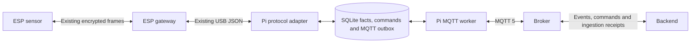

# Smart Chair MQTT specification

Revision 2 — proposed standalone feature with executable contract/reference artifacts.
The production Pi MQTT adapter has not been implemented or deployed.

Target project: `/home/strawberrypi/Desktop/Project` on the Raspberry Pi.
The current entry point is `piMQTTForwardingService.py`. This specification is
independent of the communication-windows feature and its pull request.

## 1. Scope and ownership

Implement a bidirectional MQTT interface for the existing chair protocol:

- Publish real ESP occupancy, health, movement and command-result packets.
- Accept complete configuration commands and return their durable progress and outcome.
- Preserve delivery across Pi process restarts, broker outages and duplicate packets.
- Keep MQTT payloads close to the JSON representation already understood by the ESP gateway.

The Pi owns MQTT, SQLite and command routing. The sensor owns physical state and
configuration. The gateway translates encrypted ESP-NOW frames to/from USB JSON.
The backend owns durable MQTT ingestion and application/session logic.

No MQTT client, Wi-Fi broker connection, new packet type or MQTT credential is
added to either ESP. The existing transport decides when it can dispatch a queued
command. MQTT must not implement radio scheduling, interpret READY as a cloud
lease, or change sleep behavior. The configuration's existing radio fields remain
ordinary pass-through settings because CONFIG_SET requires the complete structure.

This design does not add remote reboot, firmware update, provisioning, NVS erase,
arbitrary radio TX, cancellation, partial configuration updates or CONFIG_GET.
Those require separately specified operations. Telemetry currently reports a
configuration revision, not a complete configuration readback.

### Existing placeholder

The inspected service publishes DHT22/BH1750 or simulated readings to
`Project/piForwarding`, then subscribes to the same topic. It uses a PID-dependent
client ID, an in-memory publisher and no chair packet routing or durable command
inbox. The Pi currently has Paho MQTT 2.1.0 and pyserial 3.5 installed; Mosquitto and
the placeholder service were active during inspection.

`Project/piForwarding` is a legacy demonstration topic. Do not alias it to the new
command topic or interpret its environmental/demo JSON as an ESP chair packet.
Environmental sensing, if retained, must have a separate future data contract.
Do not replace or restart the running placeholder until the implementation and
its deployment have been reviewed.

## 2. Architecture and delivery boundaries



There must be one serial owner, one command dispatcher and one authoritative
SQLite database for each gateway. MQTT network callbacks must not open the serial
port or transmit ESP frames. They submit bounded work to the database/adapter.
The local CLI and MQTT must use the same durable command inbox and dispatcher.

The delivery confirmations have different meanings:

| Confirmation | Meaning | Does not establish |
| --- | --- | --- |
| ESP MAC completion / USB `tx_result` | One radio transmission completed | Pi/backend persistence or command application |
| ESP `EVENT_ACK` | Pi committed the exact reliable sensor fact and its forwarding work | MQTT or backend delivery |
| MQTT QoS 1 `PUBACK` | The next MQTT peer accepted that publication | Backend database commit or ESP command execution |
| MQTT `MQTT_ACK` defined here | The designated backend durably ingested a publication | Completion of later application business logic |
| ESP `COMMAND_RESULT` | The sensor produced a durable command outcome | Timely delivery before the request deadline |

QoS 1 permits duplicate delivery. Its acknowledgement is hop-local; application
identity and durable ingestion remain part of this contract. See
[MQTT 5, section 4.3.2](https://docs.oasis-open.org/mqtt/mqtt/v5.0/os/mqtt-v5.0-os.html).

**Default reliability policy:** reliable ESP facts and command-progress reports
remain in the Pi's MQTT outbox until a backend `MQTT_ACK` is committed. Broker
PUBACK alone does not remove them. This requires a backend receipt handler as
part of the first complete implementation; a dashboard alone is insufficient.

## 3. Versions, identities and encoding

| Item | Rule |
| --- | --- |
| MQTT | MQTT 5.0 over TCP; no silent MQTT 3.1.1 fallback |
| Topic/API version | `smartchair/v1`; outer JSON `schema_version: 1` |
| ESP version | Inner `message.version: 2`; independent of the MQTT version |
| Payload | One UTF-8 JSON object; no JSON-lines framing; empty retained payloads are allowed only for explicit projection tombstones |
| JSON numbers | Integers where specified; booleans are not integers; reject NaN/Infinity and duplicate object keys |
| Payload limit | 16,384 UTF-8 bytes; configuration submissions limited to 4,096 bytes |
| Topic limit | 256 UTF-8 bytes; identifiers contain no `/`, `+`, `#` or NUL |
| `site_id`, `bridge_id`, `consumer_id` | `[A-Za-z0-9_-]{1,32}`; explicit deployment configuration |
| `node_id` | Existing ESP rule: `[A-Za-z0-9_-]{1,15}` |
| Boot IDs and generations | Existing 16-character lowercase hexadecimal strings; never JSON floating-point numbers |
| UUIDs | Canonical lowercase, nonzero UUID strings |
| UTC timestamps | Integer Unix milliseconds in `0..9007199254740991`; `null` only where explicitly allowed |

`bridge_id` is stable across restarts and independent of hostname/PID changes.
An `instance_id` is a new UUID for each service process, used only for diagnostics.

Provision one persistent `node_epoch` UUID per node installation. It is Pi/MQTT
metadata, not a firmware field. It stays unchanged across normal boots, firmware
uploads and service restarts. An explicit sensor-state reset or replacement that
restarts its durable boot generation requires a deliberate new epoch, clearing
old retained projections and fencing old queued commands. Never automatically
change the epoch because a packet looks old or a database failed to load.

Epoch change is an explicit maintenance operation. Fence old accepted jobs from
dispatch immediately; they retain their history and expire at their original
deadlines with reason `epoch_changed`. Clear old retained state and command-status
projections. Do not reassign old publications/facts to the new epoch. Quiesce and
flush the serial adapter at the handover so pre-maintenance buffered packets are
not stamped with the replacement installation's epoch.

The handover is a persisted `ACTIVE → FENCED → TOMBSTONING → ACTIVE` maintenance
transaction sequence, not a configuration-file edit. In FENCED, stop command
submission and retained publishing for that node; bump its publisher generation.
Terminate the old MQTT connection and discard its client's queued retained sends
before installing a fresh client. A callback from an old connection/epoch cannot
complete new work. Mark old-epoch projection jobs superseded so recovery never
replays them. Preserve old non-retained events/report updates with their old epoch.

Persist and publish zero-byte retained tombstones for the node's state and every
retained command-status topic recorded for its previous epoch. Wait for positive
broker PUBACKs before publishing new-epoch retained values or enabling command
submission. Do not interleave old retained retries with these tombstones. If the
broker is unavailable, remain fenced across restart; continue storing new sensor
facts under the explicitly provisioned new epoch, without enabling dispatch or
retained publication. Unexpected pre-barrier sensor data must not be auto-assigned
an epoch. On restart resume the persisted phase, not an assumed ACTIVE state.

Controllers obtain the current epoch from provisioning or the retained state;
never guess it from a sensor boot ID.

Sensor fact identity is `(site_id, node_id, node_epoch, boot_id, seq)`. Backend
deduplication uses this identity, including when the same fact is republished
with another publication ID after an operator-controlled replay.

`publication_id` is a UUID allocated once per durable MQTT publication and stored
with its exact topic/payload. Retries preserve it. Backend ingestion receipts
refer to this ID. MQTT packet identifiers and DUP flags are never database keys.

## 4. Topics

Let `N = smartchair/v1/<site_id>/nodes/<node_id>` and
`B = smartchair/v1/<site_id>/bridges/<bridge_id>`. Names are case-sensitive.

| Topic | Publisher → subscriber | QoS | Retain | Pi storage / backend receipt |
| --- | --- | --- | --- | --- |
| `N/events` | Pi → backend/apps | 1 | No | Durable outbox; backend receipt required |
| `N/movement` | Pi → backend/apps | 0 | No | Bounded RAM only; no receipt |
| `N/movement/loss` | Pi → backend/apps | 0 | No | Bounded RAM only; no receipt |
| `N/state` | Pi → apps | 1 | Yes | Regenerable latest projection; PUBACK only |
| `N/commands/config` | Controller → Pi | 1 | **No** | Durable command admission before Pi PUBACK |
| `N/commands/<command_id>/updates` | Pi → backend/apps | 1 | No | Durable reports; backend receipt required |
| `N/commands/<command_id>/status` | Pi → controller/apps | 1 | Yes | Latest report projection; PUBACK only |
| `N/command_errors` | Pi → controller/apps | 1 | No | Bounded durable error outbox; PUBACK only |
| `B/receipts` | Designated backend → Pi | 1 | **No** | Commit receipt before Pi PUBACK |
| `B/status` | Pi / broker Will → apps | 1 | Yes | Live bridge status; no backend receipt |

Do not retain commands, raw events, movement, receipts or report-update streams.
Do not subscribe the bridge to its own upstream event topics. It subscribes only
to the configured nodes' exact command topics and its own receipt topic.

Each node has one configured bridge owner. Multiple gateways may later be served
by one Pi with separate serial adapters, but two bridges must not execute the same
node's command subscription. Shared-subscription load balancing is outside v1.

All JSON publications set MQTT Payload Format Indicator to UTF-8 and Content Type
to `application/json`. Reliable events/reports have no MQTT Message Expiry.
Controllers set Message Expiry on commands to
`ceil((expires_at_ms - controller_now_ms) / 1000)`, recomputed on each retry.
The unchanged payload deadline remains authoritative at the Pi.

Command/receipt subscriptions use QoS 1, Retain Handling 2 and Retain As Published
true. The Pi rejects any received command/receipt with RETAIN set, including a
live retained publication. These subscription options avoid treating a stored
retained value as a new instruction; see
[MQTT 5, section 3.8.3.1](https://docs.oasis-open.org/mqtt/mqtt/v5.0/os/mqtt-v5.0-os.html).

## 5. ESP → MQTT mapping

The gateway already emits:

```json
{
  "kind": "telemetry",
  "source_mac": "02:00:00:00:00:01",
  "message": {
    "version": 2,
    "type": "STATE_SYNC",
    "node_id": "chair-01",
    "boot_id": "41c966a5ce723b09",
    "seq": 120,
    "uptime_ms": 4300,
    "occupied": true,
    "battery_mv": null,
    "config_revision": 2,
    "health_flags": 2,
    "boot_generation": "0000000000000007"
  }
}
```

After provisioned MAC/node validation and a successful transaction, publish this
on `smartchair/v1/lab/nodes/chair-01/events`:

```json
{
  "schema_version": 1,
  "bridge_id": "pi-01",
  "node_epoch": "f1db6f13-b820-4e1f-ae13-8924dd8fa734",
  "publication_id": "d5307c2e-1bbc-4cea-bd6d-87065ab17a0f",
  "source_mac": "02:00:00:00:00:01",
  "received_at_ms": 1800000000123,
  "boot_generation": "0000000000000007",
  "message": {
    "version": 2,
    "type": "STATE_SYNC",
    "node_id": "chair-01",
    "boot_id": "41c966a5ce723b09",
    "seq": 120,
    "uptime_ms": 4300,
    "occupied": true,
    "battery_mv": null,
    "config_revision": 2,
    "health_flags": 2,
    "boot_generation": "0000000000000007"
  }
}
```

The `message` object is the ESP JSON packet, unchanged in meaning and field types.
Only field order/whitespace may differ. Do not rename `occupied`, scale raw axes,
convert identities to decimal, invent timestamps on the sensor, replace null
battery values with zero, or add MQTT metadata inside that object.

`source_mac` comes from the validated USB envelope, not a cloud-supplied value.
`received_at_ms` is the Pi's **first** receipt time; it is not an acquisition UTC
time. It may be null when UTC is untrusted. `boot_generation` outside `message`
comes from the Pi's established boot map; it is null if the boot is not yet known.
Do not add a generation to inner packets whose wire type does not carry it.
Freeze this metadata in the publication record; a retry must not become a new
observation. Never derive event ordering from uptime or MQTT arrival order.

### Routing every existing packet type

| ESP type | MQTT treatment |
| --- | --- |
| OCCUPIED, VACATED, HEARTBEAT, STATE_SYNC, BATTERY_LOW | `N/events`, reliable envelope |
| COMMAND_RESULT | `N/events`, plus correlated command-report update when the command is known |
| MOVEMENT_BATCH | `N/movement`, same envelope but `publication_id: null`; QoS 0 |
| MOVEMENT_LOSS | `N/movement/loss`, `publication_id: null`; QoS 0 |
| COMMAND_RECEIPT | Local command progress input; only `received` advances progress; no raw public event |
| READY, READY_PROOF | Local transport controls; no MQTT projection or replay |
| EVENT_ACK, READY_PROBE | Generated locally by the existing protocol adapter; not cloud APIs |
| CONFIG_SET | Accepted only through the command-template contract below |

The existing decoder remains authoritative for frame ranges, exact fields,
signed axes, strictly increasing sample offsets, maximum 75 samples and valid
empty final batches. JSON represents samples as `offset_ms, ax, ay, az, gx, gy,
gz`; `samples.length` is the wire count. Accel/gyro range bytes are currently fixed
by the codec and are not extra JSON fields. Preserve `end_reason` and all actual
offsets. MQTT service drops must not be added to the sensor's `dropped_batches`;
count them separately as `mqtt_best_effort_dropped` in bridge diagnostics.

### Retained state

`N/state` contains the same envelope shape with `publication_id: null` and the
latest generation/sequence-qualified **reliable** telemetry packet in `message`.
It represents the last durable physical snapshot, not current RF availability,
online status or a complete sensor configuration.

Use a separate MQTT state projection. Existing `Store.current_state` can include
best-effort packets; do not blindly publish that row or manufacture STATE_SYNC
packets from it. READY, movement and receipts must not trigger retained-state
updates. Establish a boot's generation through a genuine STATE_SYNC, then choose
the greatest `(generation, seq)` among eligible persisted reliable facts. When a
previously unknown boot is established, reconsider its already stored facts.
Old generations/sequences never replace newer state. A new epoch requires an
explicit retained-state tombstone before publishing the replacement installation.

Only one publication per retained topic may be in flight. Coalesce unsent
projections, never an in-flight payload, and publish their latest value after
the earlier one finishes. After reconnect/restart, retry the outstanding older
projection before its newer successor. This prevents a late retry from replacing
fresh retained state with an older snapshot.

## 6. MQTT → ESP configuration command

Publish to `smartchair/v1/lab/nodes/chair-01/commands/config`:

```json
{
  "schema_version": 1,
  "node_epoch": "f1db6f13-b820-4e1f-ae13-8924dd8fa734",
  "expires_at_ms": 1800000300000,
  "message": {
    "version": 2,
    "type": "CONFIG_SET",
    "node_id": "chair-01",
    "command_id": "37c7984c-33eb-4dcc-93be-e2b11bb2436d",
    "revision": 3,
    "heartbeat_s": 900,
    "movement_batch_s": 3,
    "movement_enabled": true,
    "radio_windows_enabled": true,
    "radio_interval_s": 30,
    "radio_open_s": 5,
    "radio_motion_tail_s": 10
  }
}
```

This is an ESP-shaped **command template**, not a complete wire frame. The
controller supplies the command UUID and complete configuration. It must omit
`boot_id` and `seq`; the Pi allocates its own control identity on each dispatch
attempt. Those header values are not the sensor's boot/sequence and are not the
command's idempotency key. Unknown fields, including caller-supplied headers,
partial patches, arbitrary ACK targets and `source_mac`, are rejected.

The Pi constructs the existing USB request without MQTT-only fields:

```json
{
  "kind": "command",
  "request_id": 1001,
  "message": {
    "version": 2,
    "type": "CONFIG_SET",
    "node_id": "chair-01",
    "boot_id": "f12b4be312000001",
    "seq": 74,
    "command_id": "37c7984c-33eb-4dcc-93be-e2b11bb2436d",
    "revision": 3,
    "heartbeat_s": 900,
    "movement_batch_s": 3,
    "movement_enabled": true,
    "radio_windows_enabled": true,
    "radio_interval_s": 30,
    "radio_open_s": 5,
    "radio_motion_tail_s": 10
  }
}
```

The gateway validates and encodes this using its existing binary codec. There is
no new radio packet format. `schema_version`, `node_epoch`, `expires_at_ms`, MQTT
publication IDs, topic names and USB `request_id` never enter the ESP frame.
Use `Bridge.next()` and `Bridge.send()`; do not call raw serial write for commands
or bypass the existing dispatcher by reacting directly to an MQTT callback.
Dispatch accepted jobs FIFO per node, with at most one active command for that
node. A later request does not silently replace an older one. Busy/no response
keeps the head eligible until its result or expiry; terminal/expired work releases
the next job. Different nodes may progress independently through their adapters.

### Admission and idempotency

1. Require the exact allowed topic, QoS 1 delivery, no RETAIN, valid bounded JSON,
   supported versions, matching topic/body node and matching provisioned epoch.
2. Validate the complete configuration with the existing `configuration()` rules.
   Revision is uint32 including zero; intervals/tail are nonzero uint32; booleans
   are exact; open time must not exceed interval. Do not silently increase revision.
3. Look up the command UUID **before** rejecting an already known request because
   its deadline has passed. A semantic duplicate returns its current status and
   never reinserts it or creates another radio job.
4. Canonical identity content is `(site, node, epoch, expires_at_ms, command
   template)`. Normalize JSON key order/whitespace only. Same UUID with different
   content or deadline is `command_id_conflict`; preserve the original command
   and its retained status. MQTT properties and delivery IDs are not hash inputs.
5. For a new valid request, require trusted Pi UTC, expiry after admission time,
   and no more than 24 hours ahead. Recheck after acquiring the SQLite write lock.
   A new structurally valid already expired request is stored as `expired` without
   a radio job. An excessive future lifetime is an admission error.
6. In one transaction persist the request/fingerprint, local command job, initial
   status report and both its MQTT update/projection work. Then acknowledge the
   inbound MQTT delivery. Controller-to-broker PUBACK alone is not Pi admission;
   the controller waits for a `queued`, `expired` or terminal command report.

Identical MQTT redelivery after a crash must repair/retry existing report work,
not execute a new command. Preserve UUID history/fingerprints through ordinary
restarts and do not silently drop a command tombstone to permit UUID reuse.

Admission errors use `N/command_errors`, with `schema_version`, `bridge_id`,
`node_epoch`, `error_id` UUID, safely parsed `command_id` or null, `reason`,
`retryable` boolean and `received_at_ms`. Reasons include `invalid_json`,
`invalid_schema`, `unsupported_version`, `unknown_node`, `node_mismatch`,
`epoch_mismatch`, `retained_command`, `invalid_config`, `clock_untrusted`,
`deadline_too_far`, `command_id_conflict` and `queue_full`. Do not echo untrusted
request bodies or broker credentials. A durable rejection is followed by MQTT ACK
so a poison message does not loop. If its bounded error journal cannot commit,
withhold ACK and disconnect/back off. Error reports never overwrite a valid
command's canonical status. A retryable admission error has not queued a job;
the caller may retry the same unchanged request while its expiry is still valid.

### Required controller retry behavior

The controller must keep a durable submission outbox containing the exact topic,
request bytes/semantic content, command UUID and original expiry before publishing.
Subscribe to that UUID's retained status topic before the first submission. Until
a matching-epoch report confirms Pi admission (`queued`, `delivered` or a terminal
status), retry the same request every 15 seconds, including after controller restart
or broker reconnect. Recompute only MQTT Message Expiry; never extend the payload
deadline or allocate a new UUID to retry the same operation. A broker PUBACK alone
must not clear this controller outbox.

A matching admission report ends submission retries, not monitoring of the command.
At the request deadline stop submitting. If no admission report was ever observed,
record a controller-local `admission_unknown` outcome; do not assert that the Pi
rejected the request or that the sensor did not execute it. Keep monitoring for an
authentic late report. This controller retry requirement is essential because a
fresh Pi process resets its broker session as specified in section 11.

### Deadline semantics

Expiry is the latest time the Pi may initiate/continue submission, not a promise
that the sensor will never apply an already transmitted command afterward. The
sensor has no UTC deadline field. Bytes already accepted by serial/radio hardware
cannot be recalled. There is no cancellation or automatic rollback.

Use authoritative integer-millisecond deadlines in the MQTT inbox and recheck
before each serial write through the dispatch guard. Retain the existing bridge
deadline checks; its REAL-seconds compatibility column is not the sole authority.
Also cap an admitted job with a monotonic deadline derived from remaining lifetime
so a backward UTC adjustment does not extend it within the same process. On a
restart recalculate only after UTC is trusted. Forward clock jumps may expire work
early. Loss of clock trust pauses new admission and dispatch, while reliable sensor
storage and forwarding continue; unknown reception UTC is represented as null.

Do not dispatch again after expiry. An authentic late result is still persisted,
forwarded and ACKed, and updates the report's result evidence while its `expired`
status remains expired. Never equate expired/no response with proof of non-execution.

## 7. Command reports and sensor results

The public lifecycle deliberately follows the existing Pi store:

| Status | Trigger / meaning |
| --- | --- |
| `queued` | Pi durably accepted the command; execution is pending |
| `delivered` | Sensor COMMAND_RECEIPT says `received`; not proof of application |
| `applied` | Reliable COMMAND_RESULT says `applied` or `already_applied` |
| `rejected` | Reliable COMMAND_RESULT reports another terminal outcome |
| `expired` | Queued/delivered request passed its dispatch deadline |

`queued → applied/rejected` is valid when the receipt was lost. `queued` or
`delivered` may become `expired`. Applied/rejected/expired are terminal for
dispatch. `COMMAND_RECEIPT busy` leaves the job eligible for the existing retry
policy; it does not finalize it. A reliable `COMMAND_RESULT busy`, if received,
maps to `rejected` consistently with the present store, retaining the raw status.
Other receipt statuses do not fabricate a terminal outcome.

The first terminal result finalizes applied/rejected status. Later result facts
remain archived; an inconsistent later result must produce a diagnostic rather
than silently reverse the command's established outcome. Expired commands retain
their first late-result evidence and record subsequent facts without rescheduling.

Every meaningful report change increments persisted `report_seq` in
`1..9007199254740991`. Exhaustion fails closed. Publish each change on `/updates`
with a stable publication ID; publish the latest report on `/status` with
`publication_id: null`. The retained projection follows the per-topic ordering
rule in section 5. Clients order reports by epoch, command UUID and report_seq,
not MQTT arrival order. Republishing the same status after duplicate admission
does not increment report_seq.

An applied report looks like:

```json
{
  "schema_version": 1,
  "type": "COMMAND_STATUS",
  "bridge_id": "pi-01",
  "node_epoch": "f1db6f13-b820-4e1f-ae13-8924dd8fa734",
  "publication_id": "cae4ebbd-b782-42b2-bff6-c571360d253c",
  "command_id": "37c7984c-33eb-4dcc-93be-e2b11bb2436d",
  "report_seq": 2,
  "status": "applied",
  "requested_revision": 3,
  "expires_at_ms": 1800000300000,
  "updated_at_ms": 1800000001500,
  "late_result": false,
  "reason": null,
  "message": {
    "version": 2,
    "type": "COMMAND_RESULT",
    "node_id": "chair-01",
    "boot_id": "41c966a5ce723b09",
    "seq": 121,
    "uptime_ms": 5677,
    "occupied": true,
    "battery_mv": null,
    "config_revision": 3,
    "health_flags": 2,
    "command_id": "37c7984c-33eb-4dcc-93be-e2b11bb2436d",
    "status": "applied"
  }
}
```

Before a result, `message` is null. `updated_at_ms` may be null if clock trust is
lost after admission. `requested_revision` comes from the command; the result's
`config_revision` is the sensor's active revision at result creation. A repeated
UUID can return a historical outcome without rolling back newer settings; do not
treat that outcome as full current-configuration readback. Actual result JSON
does not gain a new `revision` field.

An unknown command's authentic COMMAND_RESULT is still a reliable sensor fact
and must be stored/forwarded/ACKed. Record `unmatched_command_result` locally;
do not invent an accepted request, deadline or canonical command-status row.

## 8. Reliable ESP ingress transaction

For each validated reliable frame:

1. Begin one SQLite transaction and check exact event identity/content.
2. Insert the fact once, preserving first receipt time. Validate/establish boot
   generation and update eligible retained-state data without rollback.
3. Insert an immutable `/events` publication if missing. Update correlated command
   state and create its report/update/projection work in the same transaction.
4. Commit with WAL and `synchronous=FULL`.
5. Only then allow the existing adapter to enqueue the exact ESP EVENT_ACK.

Do not forward the current bridge's `accepted` stdout into a separate MQTT process
and assume durability: the sensor might already have been ACKed before MQTT work
was saved. The existing Store transaction must be extended with the MQTT outbox
work (or an equivalent same-database transactional hook). A second sidecar database
written after `Store.accept()` returns cannot provide this guarantee.

A duplicate with identical content reuses the fact/publication and is ACKed again
after a successful transaction. It does not create another report or state update.
An identity reused with changed content is an error and is not sensor-ACKed.
Storage failure produces no sensor ACK; native reliable retries remain in charge.

When enabling MQTT on an existing Pi database, perform an explicit, restartable
backfill of retained reliable facts into the outbox before claiming forwarding is
caught up. Use uniqueness constraints and progress checkpoints. Do not silently
skip facts previously ACKed to the sensor. Previously pruned history is unavailable
and must be reported as such.

## 9. MQTT outbox and backend receipts

Outbox records store the exact publication ID, topic, UTF-8 payload, delivery class,
expected consumer, logical fact/report key, first creation time, retry state and
broker/backend acknowledgement state. Sensor fact and command-report payloads
are immutable after commit. New receipt metadata does not rewrite their payload.

For receipt-required rows:

1. Publish QoS 1. A successful `publish()` enqueue is not broker delivery.
2. Track broker PUBACK separately. Start a 30-second monotonic acknowledgement
   deadline at successful submission to the bounded client queue. A negative
   reason code is classified below; it is never a successful delivery. Do not
   free durable work on a disconnect.
3. Wait for the designated backend's receipt. If absent after 15 seconds, republish
   with the same publication ID, exponentially backing off to 300 seconds with
   jitter. Never start an application retry while that row is still MQTT-in-flight.
4. Commit an accepted receipt, then remove the pending payload or mark it completed.
   Keep the original event/report archive and a durable completion tombstone keyed
   by both publication ID and logical fact/report key. A later sensor duplicate
   must recognize that the publication already completed rather than enqueue it
   again. Pending quotas count only unfinished work; deleting a completed payload
   does not delete this deduplication evidence.

### Publication state and stalled broker recovery

Persist logical states `PENDING`, `MQTT_INFLIGHT`, `WAITING_RECEIPT`, `COMPLETED`
and `QUARANTINED`, keeping broker-attempt history separate from the immutable
publication. A successful native PUBACK moves receipt-required work to
WAITING_RECEIPT and PUBACK-only work to COMPLETED. An application receipt may
complete any unfinished receipt-required row, including a quarantined one, if
its publication/expected-consumer identity matches.

A 30-second broker-ACK timeout applies even while PINGRESPs arrive, and even if a
backend receipt already completed the logical row. That native transaction still
occupies an MQTT in-flight slot until its PUBACK or connection recovery. On timeout
close/abort the connection, invalidate its incoming ACK tokens, and reconnect with
backoff; preserve the durable publication and any live client's protocol state.
Do not timer-resend an unacknowledged native PUBLISH on an open connection. Same-
connection application retries are *new* MQTT publications only after the earlier
native attempt has completed and the backend receipt is overdue. This follows
[MQTT 5 section 4.4](https://docs.oasis-open.org/mqtt/mqtt/v5.0/os/mqtt-v5.0-os.html).

Monitor SUBACK with the same 30-second deadline. Until all required subscriptions
are positively acknowledged with the required granted QoS, expose
`subscriptions_ready: false`, keep incoming
commands fenced from execution, and recover the connection on timeout. This
handshake gate applies to newly ingested MQTT requests; already admitted local
jobs continue under their existing deadline/transport policy during MQTT outages.
Connection health must not be inferred solely from TCP or successful PINGRESP.

### Negative acknowledgements and quarantine

| Broker response | Action |
| --- | --- |
| PUBACK `0x00` or `0x10` | Broker accepted; `0x10` does not mean a backend received it; continue waiting for MQTT_ACK when required |
| `0x97` quota exceeded | Retain work, release native attempt, retry with 1..300 s exponential backoff/jitter; alert if persistent |
| `0x87` not authorized, `0x90` topic invalid, `0x99` payload format invalid | Persist QUARANTINED with reason, attempt and diagnosis; no automatic application retry |
| `0x91` packet identifier in use | Stop publishing on that connection and recover session/client state; quarantine an unresolved repeated mismatch |
| Other failure/unknown reason | Fail closed into QUARANTINED and diagnose; do not guess that it is transient |
| DISCONNECT packet too large / local oversized payload | Preserve and quarantine offending work; do not retry unchanged bytes forever |

Quarantine never deletes the fact, grants a backend receipt, marks a command
applied, or frees its pending-payload accounting. It releases the native attempt
so one poison publication does not block unrelated deliverable work. Expose
quarantined count/oldest age and a reason histogram. After fixing broker policy
or a validated serialization issue, an explicit local administrative redrive may
retry the *same* publication ID and bytes. Changed topic/payload requires an
explicit replacement publication with a new ID linked to the original; retain
its audit history. Never edit already-published bytes under an existing ID.

The backend must subscribe to `/events` and `/commands/+/updates`, persist each
publication and its semantic identity/report_seq before acknowledging ingestion,
and send this on the publishing bridge's `B/receipts` topic. A repeated
publication ID with a different topic or payload hash is a contract violation:
reject/diagnose it without issuing an ingestion receipt. An equal semantic sensor
fact under a different publication ID is stored as another delivery of the same
fact, not another occupancy transition. The receipt payload is:

```json
{
  "schema_version": 1,
  "type": "MQTT_ACK",
  "consumer_id": "backend-01",
  "publication_id": "d5307c2e-1bbc-4cea-bd6d-87065ab17a0f"
}
```

This is a Pi/backend control object, **not** an ESP EVENT_ACK. The Pi must never
translate it into a radio ACK. It can complete only an existing publication whose
expected consumer matches. A broker ACL must bind this receipt topic to the
designated backend account; the subscriber cannot infer a publisher's authenticated
identity from MQTT payload fields alone. Validate the exact receipt field set,
version/type, canonical UUID, configured consumer, QoS and non-retained delivery.
Invalid receipts are durably diagnosed and MQTT-ACKed without changing outbox or
radio state; they are not executed as ESP controls.

The backend re-sends a receipt for duplicate publications, including after a crash
between its database commit and receipt publication. It must not repeat business
side effects when recognizing an already ingested event. Backend receipt ingestion
on the Pi uses manual MQTT ACK after its SQLite commit. Duplicate/unknown completed
receipt IDs are ignored and MQTT-ACKed; they never recreate work. An authenticated
receipt can arrive before the sender's PUBACK callback; completing that row is
valid and a later broker callback is a no-op.

This gives at-least-once publication until **durable backend ingestion**, with
identity-based deduplication, under eventual connectivity, sufficient storage and
a conforming backend. It does not promise exactly-once business effects, survival
of simultaneous loss of all durable copies, or complete history through the ESP's
existing bounded outbox overflow. Additional dashboards need not send receipts.

## 10. Persistence layout and migration

Extend the existing protocol database, not an unrelated MQTT-only database:

| Logical table | Required invariant |
| --- | --- |
| Existing `events`, `boots`, `current_state`, `commands` | Preserve existing facts, ordering, configuration and result semantics |
| `mqtt_nodes` | Stable site/node/epoch/bridge ownership and provisioning metadata |
| `mqtt_command_inbox` | UUID → canonical request hash, exact request, integer expiry, epoch and admission result |
| `mqtt_command_reports` | Immutable command/report_seq records, current result evidence and projection source |
| `mqtt_outbox` | Publication UUID primary key; unique logical fact/report key; exact immutable bytes |
| `mqtt_projections` | Latest desired retained value plus separate immutable in-flight value/cursor |
| `mqtt_receipts` | Completed publication/consumer and logical fact/report identity; durable deduplication tombstones |
| `mqtt_errors` | Bounded durable admission-error publications and safe diagnostics |

The MQTT-enabled database uses schema version 3; protocol-only version 2 is the
migration source. Back up first and migrate transactionally without dropping facts
or clearing sensor state. A version-2-only binary must refuse the newer database.
Rollback requires a compatible binary or explicit restored backup; never silently
reset a database to get a process running. Existing accepted command deadlines
are preserved when the integer-MQTT inbox is added. Label existing data with its
explicitly provisioned epoch during migration. Fact keys, boot-generation maps,
current-state comparisons and command ownership must be scoped to that epoch;
old boot generations must not collide with a deliberately replaced installation.
The protocol adapter's store queries must be updated consistently, not merely
its MQTT envelopes.

Start one database owner/worker and use bounded callback queues. Do not hold a
SQLite lock while waiting for network traffic, backend receipts or serial output.
Paho callbacks never wait for delivery or perform long database/retry loops.

## 11. MQTT session and restart behavior

Use a stable client ID `smartchair-<site_id>-<bridge_id>`, MQTT 5, Session Expiry
86,400 seconds, Keep Alive 30 seconds and Receive Maximum 16. Require successful
CONNACK and every required SUBACK before operational readiness. A QoS 1
subscription granted at QoS 0 does not satisfy the requirement: fail closed and
surface the broker configuration problem instead of treating the service as ready.

| Situation | Clean Start / recovery policy |
| --- | --- |
| First connection of a newly created Paho client/process | **True**; reset any broker session whose client-side state was lost, then subscribe again |
| Network reconnect using the same still-live Paho client | **False**; resume if Session Present is true; if absent, resubscribe and recover from durable application work |
| A client object must be replaced, including epoch maintenance | Treat as a fresh process: True, then resubscribe and recover from SQLite |

For Paho use `clean_start=MQTT_CLEAN_START_FIRST_ONLY`; do not hard-code False on
initial startup. Paho does not persist the full MQTT protocol session to disk.
Application outbox rows are not a reconstruction of native packet identifiers,
subscriptions and incomplete protocol exchanges. If a fresh client unexpectedly
receives Session Present true, close and establish a clean session; never pretend
that SQLite alone restored that native session. Resetting a broker session may
discard commands that the Pi had not admitted; the durable controller retry
contract in section 6 recovers those requests until their original deadline.
Already admitted commands remain in the Pi database and are not recreated.

Use Paho's version-2 callback API and `manual_ack=True`. A worker carries
`(connection_generation, mid, qos)` for an incoming delivery. ACK only the current
connection's token after commit; an old callback cannot acknowledge a reused MID
on a new connection. Invalidate queued incoming tokens on disconnect. For the
same live client retain its outbound transaction registry and reconcile/rebind
its outstanding MIDs on reconnect, without scheduling an extra native attempt.
When constructing a fresh client discard old MID associations and rebuild only
application publications from SQLite. A missing broker session never resets
accepted commands or changes publication IDs. These semantics are documented in
[MQTT 5 section 3.2.2.1.1](https://docs.oasis-open.org/mqtt/mqtt/v5.0/os/mqtt-v5.0-os.html),
[Paho client API](https://eclipse.dev/paho/files/paho.mqtt.python/html/client.html)
and [Paho known limitations](https://github.com/eclipse-paho/paho.mqtt.python#known-limitations).

Never call `wait_for_publish()` in the serial loop or a Paho callback. Associate
outbound MIDs with a connection generation and durable row, and handle completion
races where a publish callback can arrive before the caller registers the MID.
Either serialize publishing and callback bookkeeping on one worker or reconcile
early callbacks explicitly. Restore only SQLite work on a new process; do not
mistake successful enqueue or an old MID for a receipt.

Reconnect with exponential delay 1..30 seconds plus jitter. A broker outage must
not stop sensing, serial ACK processing or already admitted local command work.
It pauses MQTT delivery and eventually invokes the documented storage limits.

## 12. Bridge presence, freshness and retained data

Before CONNECT, install a retained QoS 1 Will on `B/status`, with
`schema_version: 1`, `type: "BRIDGE_STATUS"`, `bridge_id`, `instance_id`,
`status: "offline"`, `reason: "connection_lost"` and `observed_at_ms: null`.
Use Will Delay 0. Do not put a fabricated disconnect timestamp in a prebuilt Will.

After successful connection, publish `status: "online"` with current observation
time and current `gateway_connected`, `gateway_ready`, `storage_ok`, pending
publication count, overdue backend-receipt count and best-effort drop count.
The exact online snapshot keys are `gateway_connected`, `gateway_ready`,
`storage_ok`, `subscriptions_ready`, `pending_publications`, `overdue_receipts`,
`quarantined_publications` and `mqtt_best_effort_dropped`. Readiness is false until
required subscriptions are acknowledged. Quarantine diagnostics also expose an
operator-readable oldest age/reason histogram outside the bounded status payload.
Refresh on material changes and at most once per ten seconds for counters.
Unknown values are null; a broker connection loss does not prove USB disconnected.

On graceful shutdown publish offline status and wait up to two seconds for PUBACK
outside the serial loop. Send a normal DISCONNECT only after confirmation;
otherwise abort the connection so the broker can publish the Will. Will-based
failure detection is not instantaneous.

Online means **the Pi MQTT service is connected**, not that a sensor is occupied,
awake, listening or recently observed. `N/state` is a last-known fact with a first
receipt time. Do not synthesize vacancy/offline state after an arbitrary timeout.
When no qualified state exists, clear an obsolete retained state rather than
publish a fabricated STATE_SYNC. Reconnect republishes current projections; it
does not replay transport-control messages as fresh availability.

## 13. Bounds, backpressure and recovery

Initial implementation defaults, configurable downward/upward with explicit
operator review:

| Bound | Default / action |
| --- | --- |
| Accepted nonterminal commands | 64 per node, 1,024 total; reject new admission with `queue_full` |
| Receipt-required pending outbox | 10,000 rows or 64 MiB of payload, whichever comes first |
| In-flight MQTT publications | 16 total, additionally limited by the broker's negotiated maximum |
| Best-effort MQTT RAM queue | 128 messages; drop oldest and increment the Pi-specific counter |
| Pending error reports | 1,024; bounded and rate limited per node |
| Free-disk safety threshold | 64 MiB; stop new durable admissions below it |
| Command expiry sweep | At least four times per second while running |

### Quantified reservation rules

For the 10,000-row / 64-MiB receipt-required outbox, admission must satisfy both:

```text
pending_rows + reserved_future_rows + new_rows + new_reservations <= 10000
pending_payload_bytes + reserved_future_bytes + new_bytes + new_reserved_bytes <= 67108864
```

Each accepted nonterminal command stores its initial report and reserves **three
future publication slots of 16,384 bytes each** (49,152 bytes). The maximum path is
one delivered report followed by one reliable result event and its terminal report.
A result with no received receipt consumes two slots directly. An expiry report
consumes one slot. Consume reservations and create actual rows in one transaction;
release unused reservation bytes, and release remaining reservations only after
the terminal report transaction commits. Capacity limits are admission ceilings,
not a promise that all 1,024 commands fit alongside all existing publications.

A late result for an already expired command uses ordinary capacity for its event
and late-evidence report; if unavailable withhold that sensor ACK until capacity
returns. It cannot block expiry of a nonterminal job or consume another job's
reservation. Exact duplicate facts/reports do not allocate new rows or reservations.
Unknown/unsolicited reliable facts use ordinary capacity and may be backpressured.

Keep admission-error publication storage separate: at most 1,024 records and
2 MiB of payload, with each error capped at 2,048 bytes. Keep pending retained
projection storage separate: at most 1,024 topics and 32 MiB of desired/in-flight
payload. Reserve a command's status-projection topic at its admission; release its
pending slot after its latest terminal projection is broker-ACKed. Reserve state
and bridge-status topics at startup. Reject additional admissions if their
projection reservation cannot be made. Refer to immutable report/fact rows where
possible; do not silently exceed these pools by duplicating their serialized data.

Use a 64-item inbound worker queue with 16 slots reserved for receipt work; process
receipts before new command admission. The implementation must continue servicing
outgoing error PUBACKs and old work while admission is stopped. Payload quota
checks do not reject metadata-only receipt commits, duplicate ACK decisions,
reservation release or existing-command expiry transactions. Error-pool exhaustion
withholds incoming ACK and reconnects/backoffs, rather than deleting old errors.

These are logical storage/queue reservations, not a guarantee against filesystem
failure. Maintain the separate 64-MiB free-disk threshold for new admissions; actual
ENOSPC/I/O failure still forbids ACK before successful durable commit and can
require operator intervention. Do not claim that SQLite disk space was physically
preallocated merely because a reservation counter was updated.

Capacity reservation and mandatory outbox work belong to the same transaction as
the fact/command that creates them. Do not commit and sensor-ACK a new reliable
fact when its required publication/report work could not be recorded.

At outbox capacity, stop ACKing **new** reliable facts whose transaction cannot
commit. Continue ACKing exact already committed duplicates, processing receipts,
expiring existing jobs and draining old work. Do not purge pending reliable
publications, overwrite protected command results, or silently downgrade them to
QoS 0. Best effort may be dropped during overload or disconnection, without replay.

Prioritize new reliable work and retained status over best effort, while servicing
due backend-receipt retries fairly. Event/report consumers must still tolerate
duplicates and reordering. Do not let a missing backend ACK block serial progress.

The ESP already has finite durable storage and may coalesce ordinary event history
into STATE_SYNC. Therefore an unbounded outage can lose detailed history even with
Pi backpressure. Report saturation and rely on the latest state for recovery;
never claim an exact missing-event count or reconstruct sessions from fabricated
transitions. Archive growth also consumes disk: no automatic fact/command-history
deletion is part of v1. Expose disk usage and require an explicit future archival
policy before long deployments; finite storage is a stated guarantee boundary.

Receipt-required rows stay pending regardless of broker session expiration or
broker data loss. Regenerable retained projections may be coalesced. Changing the
designated receipt consumer requires draining or explicitly migrating pending
ownership; a configuration edit must not accept arbitrary consumers for old rows.

## 14. Security and deployment configuration

- Use authenticated MQTT accounts and CA/hostname-verified TLS for network access,
  default port 8883. Plain TCP 1883 is an explicit local development profile only.
- Give a bridge write access only to its assigned nodes' output topics and its own
  status, and read access only to its assigned command topics and receipt topic.
- Give controllers command-write and status/error-read access for authorized nodes.
  Give only the designated backend receipt-write access. Dashboard accounts are
  read-only. Do not use shared administrative credentials in the service.
- Bind one bridge owner/client identity per node. Use a local exclusive service/DB
  lock; distributed failover and automatic ownership takeover are outside v1.
- Reject topic/body mismatches, wrong epochs, retained instructions, unsupported
  types and oversized payloads before dispatch. Broker ACLs enforce principal
  authorization; a supplied `consumer_id` or hypothetical `user_id` is not proof.
- Keep broker secrets outside source/specifications, using a protected environment
  file or credential facility. ESP PMK/LMK never leave the local provisioning file
  and never appear in MQTT, logs, retained status or error payloads.

Required service settings: serial path, node-to-MAC map, database path, site ID,
bridge ID, each node's epoch, broker host/port/TLS identity, stable client ID,
designated receipt consumer, clock-trust adapter and the queue/disk bounds above.
Fail startup on ambiguous ownership, missing provisioning or incompatible storage.
Do not place SSH passwords, broker passwords or pairing keys in this document.

Broker session/retained-message persistence must be configured and tested. SQLite
and backend receipts remain the application's durable recovery mechanism, rather
than assuming a broker's in-memory acknowledgement means a disk flush. For a
Mosquitto deployment, review its
[persistence and access-control settings](https://mosquitto.org/man/mosquitto-conf-5.html).

## 15. Implementation plan

This is a new Pi feature and separate review. Do not add it to the communication-
windows PR or change that feature's firmware just to implement MQTT.

1. Package/pin the existing chair protocol adapter and validators for import on
   the Pi. Reuse their CONFIG_SET, raw telemetry, deduplication and dispatch rules;
   do not maintain a second hand-coded ESP binary codec.
2. Add MQTT contract validation, topic routing and immutable envelope/report models.
3. Add transactional schema-3 migration, command inbox, projections, outbox and
   receipt handling to the same protocol-store transaction boundary.
4. Add a bounded Paho MQTT-5 worker with manual incoming ACK, session-generation
   bookkeeping, reconnects, presence and backend-receipt retries.
5. Connect the worker to the existing single serial dispatcher. The CLI and MQTT
   enqueue into one store; no second serial reader or separate execution queue.
6. Implement the backend ingestion/receipt handler and its event/report dedup keys.
7. Add offline, crash, duplicate, expiry, security and hardware integration checks.
8. Prepare a separate deployment change for `piMQTTForwardingService.py` and its
   unit/environment configuration. The checked-in unit currently uses `User=pi`
   and `/opt/piMQTTForwardingService`; verify the installed identity/path rather
   than assuming it matches the SSH account or Desktop development directory.

The intended service modules are a thin entry point, `mqtt_contract`,
`mqtt_store`, `mqtt_worker` and a protocol-adapter integration, with tests for each
durability boundary. Exact packaging is an implementation detail; the behavior,
topics and payload contract above are normative for the proposed feature.

## 16. Acceptance and failure matrix

| Test | Required observation |
| --- | --- |
| All reliable ESP types | Validate original packet, one durable fact/publication, exact sensor ACK after commit |
| ESP duplicate | One logical publication/report; duplicate can be sensor-ACKed again |
| Changed content under one identity | Reject, no sensor ACK, diagnostic |
| Pi dies before ingress commit | No ACK; sensor retry recovers work |
| Pi dies after commit before sensor ACK | Duplicate reuses saved work; no loss |
| Pi dies after sensor ACK before MQTT publish | Outbox survives and publishes after restart |
| Broker PUBACK then Pi/broker restart before backend receipt | Same publication ID remains pending and retries |
| Backend commit then crash before MQTT_ACK | Duplicate ingestion is idempotent and re-sends receipt |
| Duplicate/unknown/forged receipt | Harmless duplicate or rejection; no radio ACK generated |
| QoS-1 command duplicate, including after expiry | Same durable request/status; no new execution job |
| Same UUID with altered config, target or deadline | Admission conflict; original job/status preserved |
| Retained command on subscribe or live | Never executes; validate RAP/RH behavior against the broker |
| Receipt lost or reports out of order | Terminal result can skip delivered; report_seq prevents rollback |
| Expiry during DB work, serial encoding or partial write | Guard prevents further submission; partial-line failure reconnects |
| Applied after request expiry | Raw result archived/forwarded/ACKed; expired status stays expired with late evidence |
| Busy receipt | Existing job remains retryable; no false applied result |
| Unknown command result | Reliable fact preserved; no invented accepted command |
| Unknown boot then STATE_SYNC; old generation retry | Projection waits for ordering evidence and cannot roll back |
| Old retained publish finishes after newer projection exists | Older in-flight completes first; newest projection ultimately retained |
| Same live client reconnect vs fresh process | Resume only the live protocol session; clean/resubscribe on a new client; controller retry recovers unadmitted requests |
| Missing PUBACK while PINGRESP continues | 30-second watchdog recovers connection without losing publication or in-flight accounting |
| Backend receipt before missing native PUBACK | Logical row completes; native watchdog still recovers a stuck slot |
| Permanent PUBACK rejection | Quarantine/audit preserved; unrelated work progresses; explicit redrive only |
| Epoch handover crashes between fence and tombstone ACK | Resume persisted phase; no old retained jobs/queued client sends resurrect state |
| Outbox full with nonterminal commands | Reserved slots allow delivered/terminal/expiry reports; late facts wait on ordinary capacity |
| Process restart / changed MQTT MID | No publication loss or unrelated row completion |
| Failed SUBACK / authentication / TLS | Service exposes failure; does not claim operational readiness |
| Backend offline with broker online | Pending rows remain; retry/backpressure is visible |
| Full queue/disk or SQLite failure | No ACK for an uncommitted new fact; no reliable-row eviction |
| 75-sample movement and empty final boundary | Same signed readings/offsets/end reason; no schema inflation or fragmentation |
| Best-effort overload | Bounded RAM and separate Pi loss counter; no invented sensor loss |
| MQTT disconnect | Native serial reliability continues; no synthetic vacancy |
| Wrong epoch after replacement/reset | Old commands fenced and old retained projections explicitly removed |
| Existing version-2 database | Backup/migration/backfill preserves facts and command results |
| Placeholder deployment | No accidental ingestion/execution from `Project/piForwarding` |

The executable reference kit is in [mqtt/README.md](mqtt/README.md): a closed
JSON Schema, strict topic/semantic validator, positive/negative conformance fixtures,
and a runnable durable backend receipt example. It validates the contract and
backend ingestion boundary, not an implemented Pi outbox or command dispatcher.
Both the same-object reconnect and fresh-process session-reset paths, ACK starvation,
quarantine, reserved-capacity saturation and epoch barriers need fault-injection
coverage when the production service is implemented.

Software acceptance uses a temporary durable database, a test MQTT-5 broker,
fault-injected restart points and a simulated serial gateway. Physical acceptance
then checks real ESP event/command round trips. Hardware tests do not require new
MQTT firmware on the boards. No software-only run establishes RF reliability or
power consumption, and this specification itself implements none of these steps.

## 17. References and authority

- [Existing ESP protocol contract](https://github.com/Okumans/chair/blob/d6da663/docs/PROTOCOL_SPEC.md)
  and [ESP JSON codec](https://github.com/Okumans/chair/blob/d6da663/shared/include/protocol_json.h).
- [Existing Pi protocol store/dispatcher](https://github.com/Okumans/chair/blob/d6da663/tools/protocol_bridge.py).
- [OASIS MQTT 5 standard](https://docs.oasis-open.org/mqtt/mqtt/v5.0/os/mqtt-v5.0-os.html):
  sections 3.1.2.11, 3.3.2.3, 3.8.3.1 and 4.3.2 define the underlying MQTT semantics.
- [Paho Python API](https://eclipse.dev/paho/files/paho.mqtt.python/html/client.html)
  and [known limitations](https://github.com/eclipse-paho/paho.mqtt.python#known-limitations).
- [Mosquitto configuration](https://mosquitto.org/man/mosquitto-conf-5.html).

The topic layout, envelope, backend receipt, quotas and migration are project
design decisions proposed here. They are not features already supplied by the
current placeholder, firmware or protocol-only bridge.

## 18. Revision-2 artifact boundary

This revision fixes session restart policy, native-ACK timeouts, explicit future
capacity reservations, epoch transition fencing and permanent-failure quarantine.
The schemas and reference backend are executable review artifacts. They do not
replace `piMQTTForwardingService.py`, install a system service, flash an ESP or
implement the production Pi migration/outbox. All examples use a separate backend
database, and network tests must use an isolated loopback broker.
