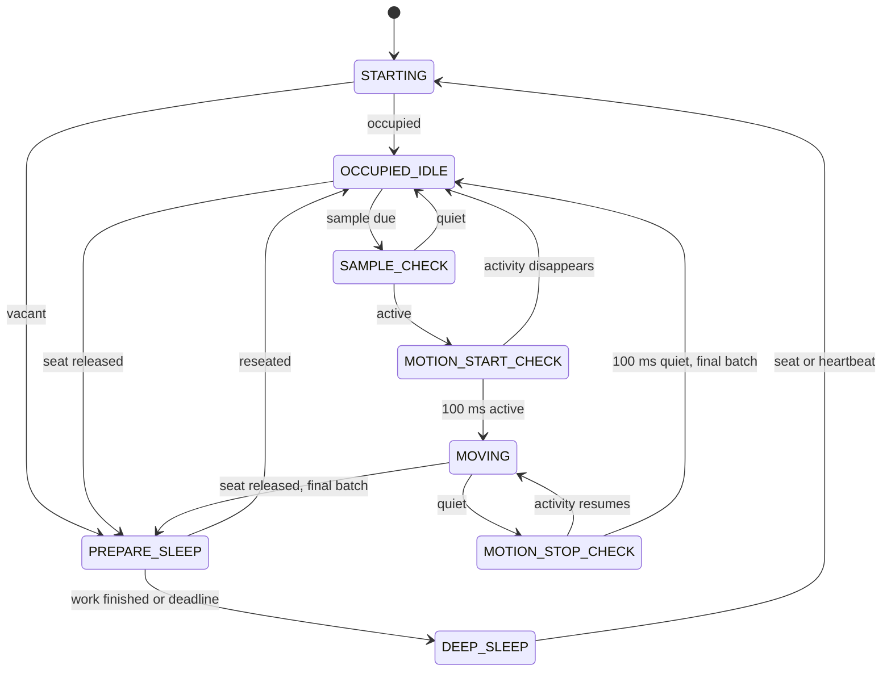
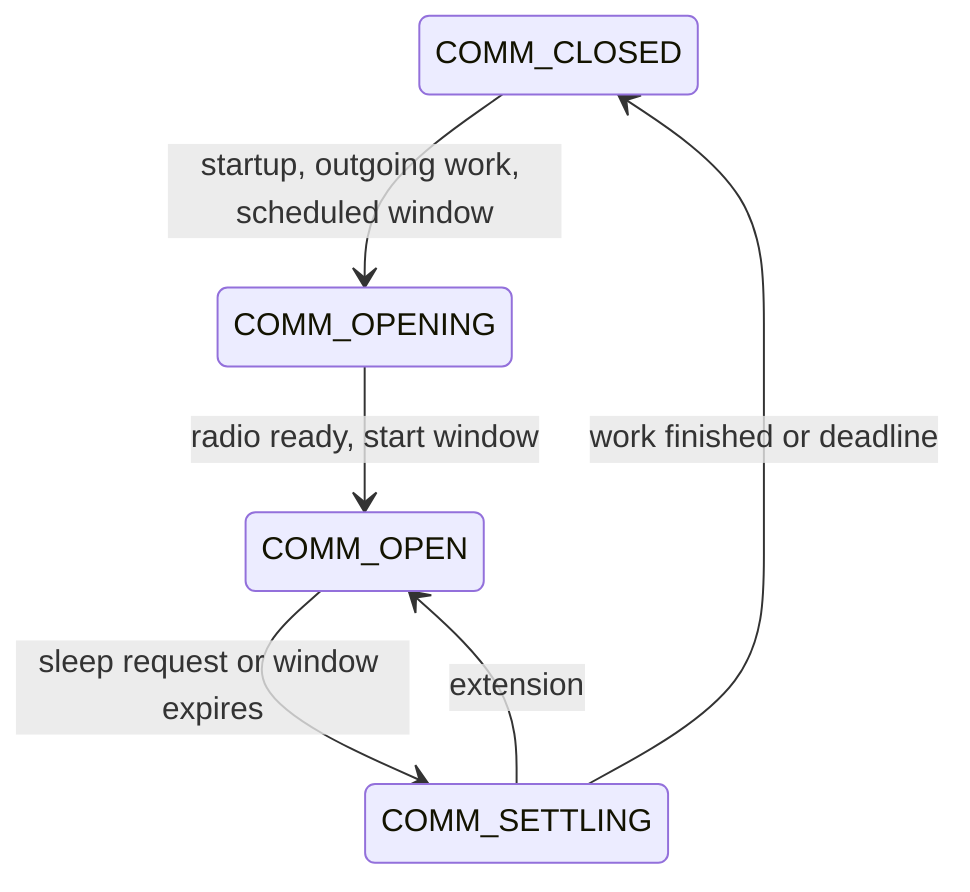

# Smart Chair protocol

Revision 3, wire version 2. This is the implementation contract; [radio-window policy](RADIO_WINDOWS_SPEC.md) gives the detailed timing and lifecycle rules. Physical acceptance is separate from build and native-test evidence.

## Ownership and defaults

Chair → encrypted unicast ESP-NOW → gateway → USB JSON → Pi SQLite.
The Pi owns logical sessions. The chair owns physical occupancy, sensing, configuration and power. MQTT, systemd, battery measurement and actual occupied light sleep are deferred.

Seat GPIO5 is active low with 50 ms debounce. MPU6050 uses SDA6/SCL7; INT21 is optional and unused by the polling adapter. Poll at 25 Hz, ±2 g and ±250 degrees/s. Preserve raw readings. Local classification uses acceleration magnitude deviation from 1 g and maximum absolute gyro axis: start above 0.15 g or 15 degrees/s; quiet below 0.08 g and 8 degrees/s; 100 ms debounce on start and stop. Initial gravity is the calibration reference; thresholds require physical tuning.

Configuration is complete and atomic: revision uint32, heartbeat_s and movement_batch_s uint32 in 1..4294967295, movement_enabled boolean, and mandatory radio_windows_enabled, radio_interval_s, radio_open_s and radio_motion_tail_s. Radio defaults are true, 30, 5 and 10 seconds; intervals and tail are nonzero and open time is no greater than the interval. Existing defaults are revision 0, 900 s, 3 s, true. Convert seconds using 64-bit arithmetic. Occupied sensing stays awake while the radio is closed.

## Binary contract

All integers are explicitly little endian. No native structure layouts are sent.
Maximum ESP-NOW v2 payload: 1470 bytes. Node ID: 1–15 ASCII alphanumeric/underscore/hyphen bytes followed by zero padding to 16. Boot ID: nonzero uint64 random on cold boot, retained through deep sleep. Sequence uint32 starts at 1; identity is (node_id, boot_id, seq). Retries preserve bytes and identity. Before wrap a new boot ID is required. Each cold boot and sequence-identity rotation increments a durable boot_generation in 1..9223372036854775807; deep sleep retains it. Persist the counter and initial STATE_SYNC atomically before sending the snapshot. Exhaustion fails closed instead of wrapping. JSON represents the generation as 16 lowercase hex digits, like boot_id.

Header (32 bytes): version u8=2 at 0, type u8 at 1, payload length u16 at 2, node ID at 4, boot ID u64 at 20, sequence u32 at 28. Wire version 1 is rejected.

Common telemetry (12 bytes): uptime_ms u32, occupied u8 (0/1), battery_mv u16 (65535 unavailable), config_revision u32, health_flags u8 (bit0 IMU unavailable, bit1 battery unavailable). Uptime is diagnostic and wraps at 32 bits.

Types and payloads:

| Code | Type | Payload after header | Delivery |
|---|---|---|---|
|1|OCCUPIED|common|reliable|
|2|VACATED|common|reliable|
|3|HEARTBEAT|common|reliable|
|4|STATE_SYNC|common, boot_generation u64|reliable|
|5|BATTERY_LOW|common|reliable|
|6|COMMAND_RESULT|common, UUID 16 bytes, status u8|reliable|
|7|MOVEMENT_BATCH|common, metadata, samples|best effort|
|8|READY|common, reason u8, listen_remaining_ms u32 (0xffffffff = null)|best effort|
|9|EVENT_ACK|target boot u64, target seq u32|control|
|10|CONFIG_SET|UUID, revision, heartbeat, batch interval, movement enabled, windows enabled, interval, open time, motion tail; 42 bytes total|control|
|11|COMMAND_RECEIPT|UUID 16 bytes, status u8|best effort control|
|12|MOVEMENT_LOSS|common, dropped_batches u32|best effort|

UUIDs are nonzero 16-byte values, represented as canonical UUID strings in JSON. Status: 0 applied, 1 already_applied, 2 revision_conflict, 3 stale_revision, 4 busy, 5 received, 6 command_conflict. READY reasons: 0 seat_occupied, 1 movement_started, 2 scheduled. Never persist, replay or application-ACK READY. Generate it afresh when occupied communication opens or movement starts. Null listen remaining means no scheduled close; timed windows compute remaining time when sent. There is no UTC clock or listen_until on the chair.

Movement metadata (14 bytes): batch_start_ms u32, duration_ms u32, sample_count u16 (0..75), accel_range u8=0, gyro_range u8=0, end_reason u8, reserved u8=0. End reasons: 0 interval, 1 capacity, 2 stopped, 3 vacant, 4 disabled. Each sample (14 bytes): offset_ms u16 and ax, ay, az, gx, gy, gz signed i16. Default full batch: 32+12+14+75*14=1108 bytes. Offsets are actual acquisition times. Candidate and stop-debounce samples are included. Flush at interval or capacity; confirmed stop takes priority. Final boundaries may be empty after a preceding flush. No idle-only batches. A buffer flush starts the next interval; gaps exceeding u16 offsets trigger an early flush.

MOVEMENT_LOSS reports a nonzero count of movement batches discarded from the bounded RAM queue since the last report. It is itself best effort: loss of the report or radio transmission is not counted, and a reset loses unreported counts. Both firmware targets and the bridge must be updated together to recognize this message.

Validate sender MAC, node ID, version, type, exact lengths, enums, occupancy, nonzero identities, sample counts, ordered offsets, ranges and configuration before processing. A gateway serves the single provisioned encrypted chair peer. Reject malformed data without changing state.

## Cooperative state engine

Time is supplied explicitly in uint64 milliseconds. Callbacks only enqueue data. The loop samples, debounces, processes controls and requests sends; reporting never waits for ACKs in a sensing loop.

Seat release applies from every occupied state. Sampling remains at 40 ms with zero occupied sleep, with no catch-up busy loop. Future OCCUPIED_LIGHT_SLEEP is allowed only when communication is closed; quiet sampling does not open it.

The occupied sensor requests a window every 30 seconds by default, opens for at least five seconds after readiness, and holds availability throughout movement and for a ten-second tail. Pending delivery may use a further bounded settling period. The gateway remains continuously available. Vacant sleep adds no communication wake timer. See [radio-window policy](RADIO_WINDOWS_SPEC.md) for ordering, READY leases, failure handling and timing.

## Durability and sleep

Persist reliable events before transmission and persist exact ACK removal. Up to 32 events; reserve one slot for STATE_SYNC. Preserve command results. Overflow coalesces ordinary history into latest STATE_SYNC; this restores current state, not missing history. Reject commands busy if protected results leave no capacity. Configuration, command deduplication record and result are one durable transaction. Keep up to 32 command UUID records. Evict the oldest acknowledged record first; a record with an outstanding result stays protected. Older revisions remain rejected after that bounded deduplication horizon. Same UUID with different content is a conflict. Same revision and identical config is already_applied; different values conflict. Failed storage never reports success or transmits an unpersisted event.

Retry each pending event at 0, 250, 750, 1750 ms within a 2500 ms round. Start a new round on wake/contact and periodically while awake. Best effort queues are bounded RAM only. Cold boot sends STATE_SYNC; timer wake sends HEARTBEAT; retain old outbox identities through all resets. NVS holds a versioned atomic blob, RTC holds the active boot identity and sequence through deep sleep.

PREPARE_SLEEP allows 2500 ms for delivery and persistence, cancels on reseating, then rechecks the physical pin before radio stop and deep sleep. Storage failure keeps the chair awake to avoid silently losing a new physical transition. Wake on low seat GPIO and configured heartbeat timer. All sleep timer multiplication is uint64.

## USB and Pi

USB uses bounded UTF-8 JSON lines up to 8192 bytes excluding LF; accept CRLF. Configure the underlying CDC receive queue for at least a complete line plus LF before startup. Discard malformed/overlong input through newline. Partial writes retain their cursor; messages never interleave. Bounded RAM output may drop messages; reliable radio retries recover them. Reset partial input/output on a hardware USB bus reset, preserving framing across transient readiness changes. Hello reports radio readiness. Structured errors only. JSON parse failures retain reason `invalid_json` and include the parser error name, byte offset and received line byte count; arbitrary command contents are never echoed.

Gateway telemetry: `{kind:"telemetry",source_mac:"...",message:{version:2,type:"...",node_id:"chair-01",boot_id:"16 hex",seq:1,uptime_ms:0,occupied:true,battery_mv:null,config_revision:0,health_flags:2,...}}`.
Emit identity, common telemetry where applicable, and only the fields belonging to the message type. Omit unrelated fields entirely. Preserve intentional nulls: unavailable `battery_mv` in telemetry and indefinite `listen_remaining_ms` in READY. Thus OCCUPIED has no command, ACK, movement, READY or boot-generation fields. Compact retransmissions still match earlier SQLite facts containing unrelated null fields; no database reset is needed.
Pi controls use `{kind:"command",request_id:1,message:{...CONFIG_SET fields...}}` or kind `event_ack` with EVENT_ACK fields. Bench kind `tx`/`rx` hexadecimal transport remains for diagnostics; protocol frames are decoded and validated in normal operation.

Pi operation requires explicit serial path, node-to-MAC mapping and SQLite path. SQLite WAL + synchronous FULL. Commit reliable event before ACK; deduplicate by identity and ACK duplicates. Track the chair-provided durable boot generation; older generations and older sequences cannot replace current state. A previously unseen boot establishes its generation via STATE_SYNC. Reject a boot that changes its generation or reuses another boot's generation. V1 storage and databases require the explicit test reset procedure in [radio-window policy](RADIO_WINDOWS_SPEC.md). Store late command results as facts without dispatching expired commands. Commands have UUID, complete config and UTC expiry, one pending dispatch per node. Serial disconnect resets framing and reconnects automatically. Emit structured JSON for a future MQTT adapter.

See TRANSPORT.md for commands and validation. Physical acceptance must cover encrypted 1108-byte frames, sample timing, configuration, durable retries, and seat/timer deep-sleep wake. Build/native checks do not establish power use or radio reliability.
