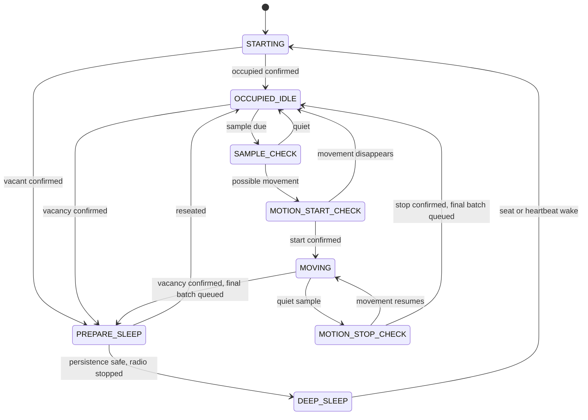
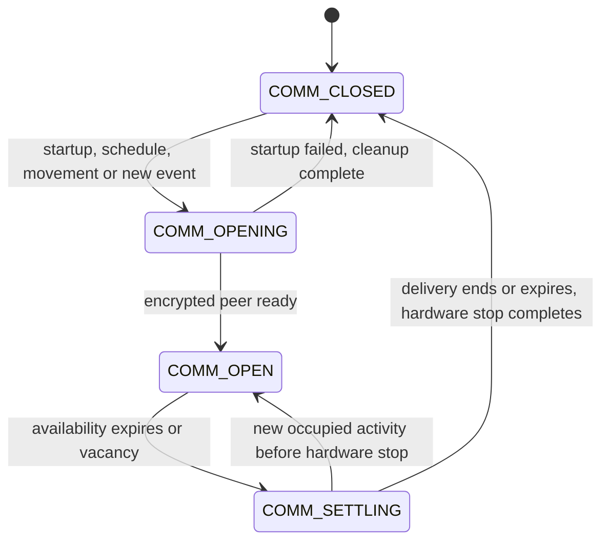

# Radio windows specification

Confirmed design, 12 November 2026, implemented as wire protocol version 2.
The revision number in `PROTOCOL_SPEC.md` is a document revision, independent of the
wire version. This specification takes precedence for the v2 changes described here.

## Purpose and defaults

The occupied chair opens its radio periodically and on activity. The ESP remains awake
and acquires MPU6050 samples at 25 Hz throughout radio-off periods. The gateway remains
available continuously. Occupied light sleep is a later feature.

Default occupied operation requests an opening every 30 seconds, provides 5 seconds of
command availability after radio readiness, and holds communication throughout confirmed
movement. Confirmed stop starts a 10-second tail. Pending delivery can add up to 2500 ms
of settling after availability expires.

A window is the advertised period during which the Pi may initiate commands. Radio
startup precedes the window. Settling follows it when delivery work remains. Thus the
configured 5 seconds does not include startup and is not a hard bound on total radio-on
time. Motion, new events, and overlapping scheduled openings can extend availability.

All engine time is monotonic `uint64_t` milliseconds supplied explicitly by the adapter.
No UTC synchronization is required. Setting occupied sleep to zero continues to preserve
the 40 ms sampling interval without a catch-up busy loop.

## Configuration and wire contract

Configuration remains a complete atomic transaction. Existing fields retain their
meaning, validation and defaults. Add the following mandatory fields.

| Field | Type | Default | Accepted values |
|---|---|---|---|
| `radio_windows_enabled` | Boolean | `true` | `true` or `false` |
| `radio_interval_s` | `uint32_t` | `30` | 1–4294967295 seconds |
| `radio_open_s` | `uint32_t` | `5` | 1–`radio_interval_s` seconds |
| `radio_motion_tail_s` | `uint32_t` | `10` | 1–4294967295 seconds |

Validate all fields even when windows are disabled. Use 64-bit arithmetic for seconds
conversion, deadline construction, and schedule advancement. An interval equal to the
open duration is valid and can result in continuous availability.

Set the header version byte to 2 for every frame. Retain the existing header, message
type codes, telemetry layouts and explicit little-endian encoding. Append the new fields
to `CONFIG_SET` after the existing movement-enabled byte, in the table order above.
Encode each Boolean as one byte with values 0 or 1.

The complete `CONFIG_SET` payload is 42 bytes.

| Payload offset | Field | Bytes |
|---|---|---|
| 0 | Command UUID | 16 |
| 16 | Configuration revision | 4 |
| 20 | Heartbeat seconds | 4 |
| 24 | Movement-batch seconds | 4 |
| 28 | Movement enabled | 1 |
| 29 | Radio windows enabled | 1 |
| 30 | Radio interval seconds | 4 |
| 34 | Radio open seconds | 4 |
| 38 | Radio motion-tail seconds | 4 |

Reject unsupported versions, incorrect payload lengths and invalid values before
changing engine state. The full default movement frame remains 1108 bytes and the
maximum ESP-NOW payload remains 1470 bytes.

Typed serial JSON, configuration equality, command UUID records, durable encoding and
Python validation carry all settings. A backend submits them with
`ChairClient.set_config`.

Persist configuration, command record and reliable command result together before
adopting the new policy. Failed persistence leaves the prior policy authoritative.
Keep existing revision, UUID deduplication and protected-result rules.

When a policy changes while occupied, restart the schedule from application time and
establish fresh availability under the new settings. Complete any in-flight transmission
before stopping hardware. Disabling windows requests continuously open communication.
Vacancy still invokes bounded shutdown. Configuration changes while vacant do not
establish an occupied schedule.

## Independent state machines

Keep operating, communication and delivery state separate. Radio scheduling belongs in
the hardware-independent engine. Hardware adapters execute lifecycle requests and report
their outcomes. Callbacks only enqueue notifications or data.

### Operating state

The sensing flow retains the existing seat and motion debounce behavior.



Vacancy applies from every occupied substate, including both motion-debounce states.
`OCCUPIED_LIGHT_SLEEP` remains reserved for the later power feature.

| Operating transition or activity | Communication action |
|---|---|
| Startup confirms occupied | Open initial window and anchor periodic schedule |
| Quiet sample | Continue sensing with the current communication state |
| Enter start debounce | Retain candidate samples until movement is confirmed |
| Confirm movement | Open or extend availability immediately and establish motion hold |
| Enter stop debounce | Retain motion hold and keep sampling |
| Movement resumes | Continue motion hold |
| Confirm stop | Queue final batch, release hold and establish tail deadline |
| Confirm vacancy | Cancel occupied schedule and hold, begin vacant preparation |
| Confirm reseating during preparation | Cancel sleep, reopen and re-anchor schedule |

Do not invent a confirmed stop if the IMU fails during motion. Keep the communication
hold until valid sensing confirms stop or vacancy occurs. This conservative failure
behavior can keep the radio active for an extended period. Quiet operation with an
unavailable IMU continues using scheduled windows and existing IMU probe behavior.

### Communication state



| State | Required meaning |
|---|---|
| `CLOSED` | Hardware is stopped and cannot send or receive |
| `OPENING` | Startup is underway and listening time has not started |
| `OPEN` | Encrypted communication is usable and occupied availability may be advertised |
| `SETTLING` | Availability has ended and bounded delivery or hardware shutdown is underway |

The existing window model closes logically in `tick()`. The v2 implementation must wait
for hardware stop completion before exposing `CLOSED`. A failed stop remains visible
in `SETTLING` and is retried. It cannot be reported as a successful radio-off period.

An opening request before hardware shutdown begins may cancel settling. An opening
request after shutdown begins is retained until shutdown completes, then starts a new
`OPENING` transition. Readiness feedback only completes an actual opening transition.

### Delivery state

Retain the existing delivery states, with their observations defined as follows.

| State | Meaning |
|---|---|
| `IDLE` | No reliable events remain outstanding |
| `RETRYING` | A reliable transmission attempt is being issued |
| `WAITING` | Reliable events remain but no attempt is due or communication is unavailable |

An event stays in the durable outbox until its exact ACK removal is persisted.
MAC delivery does not establish application delivery. Closing the radio preserves event
identity and outbox contents.

Distinguish a newly persisted event from an old pending event. A new event requests an
extra opening. Old backlog alone cannot reopen a closed radio or extend settling.
Successful recovery of a previously failed event persistence may request communication
once that event becomes durable.

## Scheduling and event precedence

Confirmed occupancy anchors the schedule. With defaults, opening requests occur at the
anchor and at 30, 60 and 90 seconds after it. Extra openings do not move the anchor.
Advance directly past missed positions without issuing catch-up openings.

The advertised listening duration starts at hardware readiness. A scheduled position
that occurs while already open extends availability to at least `now + radio_open_s`.
New reliable events establish the same minimum availability. Opening requests received
during startup retain the latest required availability and opening reason.

Process confirmed vacancy before occupied schedule or motion extensions in the same
iteration. If opening reasons coincide, prefer `seat_occupied`, then
`movement_started`, then `scheduled`. Occupied heartbeat and state-sync events use
`scheduled` as their READY reason.

Confirmed movement establishes a hold through `MOVING` and `MOTION_STOP_CHECK`.
Maintain a rolling minimum deadline of `now + radio_motion_tail_s` while held.
Confirmed stop establishes at least `stop_time + radio_motion_tail_s`, preserving any
later deadline already granted by another opening. Resumed movement restores the hold.
Periodic batch sends and ACKs do not independently extend availability.

Quiet sampling cannot open communication. A newly created heartbeat, state-sync or
command-result event can request communication immediately. Retrying an existing event
cannot. Scheduled occupied openings add no wake source during vacant deep sleep.

## Settling and timing examples

On occupied availability expiry, enter `SETTLING` and establish one deadline at
`expiry_time + 2500 ms`. Stop advertising availability for new commands. Finish queued
transmissions, receive ACKs and respond to commands already received within that budget.
Close early when work finishes. At the deadline, stop waiting for delivery and request
hardware shutdown. Routine retries and new responses to existing work cannot reset the
deadline. Newly confirmed occupied activity or a genuinely new event may reopen it.

Start fresh retry rounds for outstanding reliable events at each usable opening.
Use offsets of 0, 250, 750 and 1750 ms within each 2500 ms delivery round. Existing
while-open retry behavior continues while availability remains. Preserve the existing
32-entry outbox, state-sync reserve, protected command results and overflow rules.

An idle occupied example assumes 200 ms of startup time.

```text
0.0 s       Request initial opening
0.2 s       Peer ready, READY advertises 5 seconds
5.2 s       Advertised window expires
5.2–7.7 s   Optional settling while delivery work remains
By 7.7 s    Request shutdown, preserving unacknowledged reliable events
30.0 s      Request next scheduled opening
```

The 200 ms startup is illustrative. Hardware stop completion establishes the actual
off time. Startup and shutdown failure must be reported explicitly.

A movement example assumes no later scheduled extension.

```text
20.0 s      Movement stop confirmed, final batch queued
20–30 s     Tail keeps command availability open
30.0 s      Tail expires, close immediately if delivery work is finished
30–32.5 s   Otherwise finish bounded delivery work
By 32.5 s   Request shutdown even if reliable events remain unacknowledged
```

Settling is optional and can end early. New confirmed movement cancels closing and
restores availability. An unacknowledged reliable event survives for the next opening.
Movement batches remain bounded, RAM-only and best effort.

## Vacancy and deep sleep

Confirmed vacancy cancels the occupied schedule and motion hold. Flush any retained
movement as a final `vacant` boundary and persist a reliable `VACATED` event. A vacant
startup continues using its existing startup event selection.

If communication was closed, request startup for final delivery. Use a single 2500 ms
preparation budget measured from confirmed vacancy. A 400 ms startup leaves 2100 ms for
delivery. Do not add an occupied listening window or another full settling budget.
Vacant communication never advertises occupied READY availability.

Close early if work finishes. On budget expiry, request shutdown and retain reliable
events for the next wake. An unsent best-effort movement batch may be lost at deep sleep.
Pending best-effort data alone must not delay sleep beyond the budget.

Failed persistence keeps the chair awake until the physical transition becomes durable.
After recovery, an already-expired preparation budget does not restart automatically.
Shutdown failure also keeps the chair awake until hardware stop succeeds. Recheck the
seat immediately before sleep. Confirmed reseating cancels preparation, restarts the
occupied schedule and requests communication.

## READY and Pi command availability

Send a fresh RAM-only READY after occupied opening, at confirmed movement, and after
an applied radio-policy change. Preserve the three existing reasons. Use `scheduled`
for periodic openings, event-triggered availability and lease refreshes.

Compute `listen_remaining_ms` at transmission. Windowed operation advertises a finite
lease to the current granted deadline. During motion, refresh availability before half
the previous advertised duration has elapsed, using the rolling motion-tail deadline.
Cap finite wire values at `UINT32_MAX - 1` while retaining 64-bit engine deadlines.
Use null for continuously open occupied communication when windows are disabled.

READY is never persisted, replayed or application-ACKed. Drop obsolete queued READY
announcements when availability ends or policy changes. Coalesce refreshes so a RAM
queue cannot accumulate old availability. Expired announcements cannot extend a Pi lease.

The Pi starts commands only before the latest advertised lease expires. It may send
ACKs during settling. A command arriving near expiry may have its receipt or reliable
result completed during settling, without creating a fresh occupied listening duration.
Its normal retry can continue during a later window if necessary.

After serial reconnect or a successful radio-policy command result, clear the prior
availability and require fresh READY before starting another command. Reliable events
continue committing to SQLite before ACK generation. Retain command expiry rules and
late results as facts.

## Cooperative loop and source integration

Continue the current cooperative engine and source split. Keep motion and operating
transitions in the sensing engine, reliable work in delivery logic, and scheduling and
window policy with communication logic. Extract hardware details into named helpers so
the loop retains visible decisions at a consistent abstraction level.

The loop must perform the following ordered work.

1. Poll bounded transport work and collect received frames, transmission outcomes and
   lifecycle feedback. Preserve callbacks as queue producers.
2. Rotate boot identity if needed and process seat samples with existing debounce.
3. Probe the IMU when due, acquire due samples and process their actual acquisition times.
4. Advance persistence retries, heartbeats, scheduling, motion availability, delivery
   deadlines and vacant preparation using explicit current time.
5. Reconcile the requested radio lifecycle and report readiness, stop completion or
   failure back to the engine.
6. Select and submit one frame when engine communication and hardware readiness allow it.
7. Execute eligible vacant sleep after the final physical seat check.
8. Yield using the existing bounded polling delay.

Resample time after hardware operations. Callback frames may be processed during bounded
polling, but their command effects must not override a confirmed vacancy processed later
in that iteration.

The engine needs explicit readiness, stop-completion and lifecycle-failure inputs and an
observable requested radio action. Transport needs independent radio start/stop capability,
readiness and in-flight status. One-time USB setup must remain usable across radio cycles.

Each radio restart must restore the station/channel, power settings, keys, encrypted peer
and callbacks. ESP-NOW deinitialization removes peer information. Follow the lifecycle
ordering documented by Espressif. [ESP-NOW reference](https://docs.espressif.com/projects/esp-idf/en/latest/esp32c3/api-reference/network/esp_now.html)

Retain application queues, command identities and USB framing across radio cycles.
Clean up partially initialized hardware before retrying. Prevent late callbacks from a
previous lifecycle from completing a newer send. Do not claim readiness until peer setup
succeeds or claim closure before shutdown completes.

Bound each startup attempt to 2500 ms. Allow at least one second between failed attempts
while occupied opening work remains. Retry shutdown failures with the same minimum
spacing. Vacancy's single preparation deadline overrides occupied retry activity.
Hardware lifecycle operations must preserve cooperative sensing and must not wait for
application ACKs. Measure their effect on sample timing during physical acceptance.

## Unsupported stored state

Runtime startup rejects old or unsupported storage rather than silently clearing it,
and the Pi rejects databases with an older schema. Recover with the explicit
[sensor state reset](TRANSPORT.md#reset-sensor-state) and a new database path.

## Acceptance criteria

Deterministic engine and integration tests must cover the following cases.

- Startup occupied and vacant, delayed readiness, scheduled cadence, missed periods and
  overlapping openings without catch-up bursts.
- Quiet 40 ms sampling while closed, retained start candidates, confirmed movement from
  closed, stop debounce, tail expiry and resumed movement.
- IMU failure during motion, continued probing and conservative communication hold.
- Vacancy during opening, motion, settling and hardware shutdown, including reseating.
- One vacant preparation deadline with startup charged against it, persistence failure
  and hardware-stop failure.
- Missing and duplicate ACKs, Pi outage, bounded settling and delivery at a later window.
- New events opening communication without old outbox entries repeatedly reopening it.
- READY freshness, finite leases, refresh loss, queue coalescing, policy changes, serial
  reconnect and command expiry near a window boundary.
- Atomic configuration, zero/minimum/maximum values, invalid interval relationships,
  revision conflicts, UUID replay and failed persistence.
- Repeated hardware cycles, partial startup, retry spacing, late callbacks, encryption
  restoration, USB partial writes and framing preservation.
- Wire v2 payload lengths and maximum movement size, unsupported v1 rejection, and clear
  failure for old storage.

Physical acceptance must measure radio-off periods, encrypted large-frame delivery after
restart, command round trips, sample timing during transitions, outage recovery and vacant
seat/timer wake. Power reduction remains a measurement outcome.

## Later occupied light sleep integration

The periodic schedule uses elapsed monotonic time independently of CPU sleep. A future
occupied-sleep adapter must arm its wake timer for the earliest due sample, communication
opening or other required engine action, and also wake on seat release.

Only completed `CLOSED` communication permits occupied light sleep. Opening, open and
settling states keep the ESP awake. Motion confirmation and stop debounce also keep it
awake. A scheduled opening wakes the ESP, starts hardware, then begins listening after
readiness. The radio-window implementation itself keeps occupied sleep disabled.
